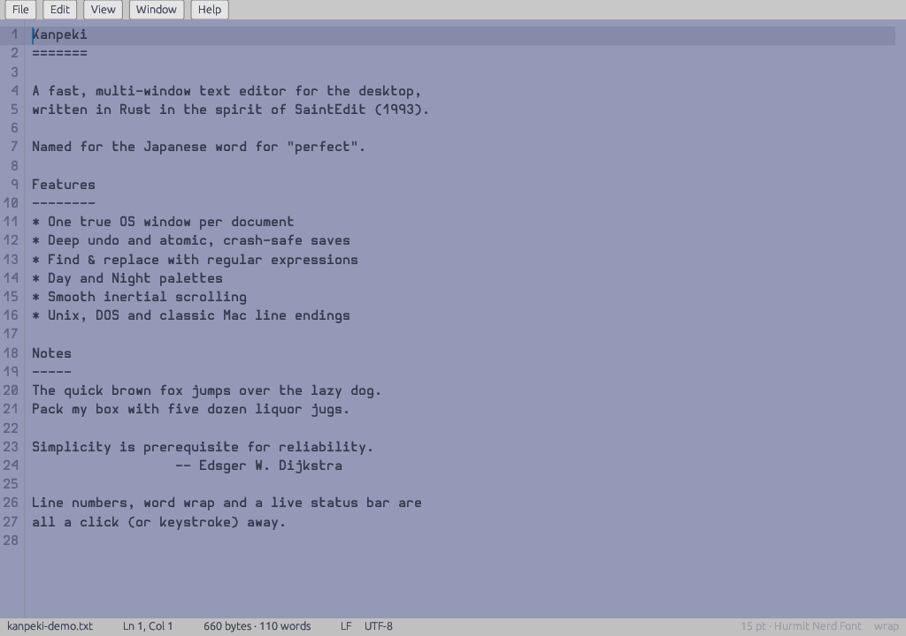
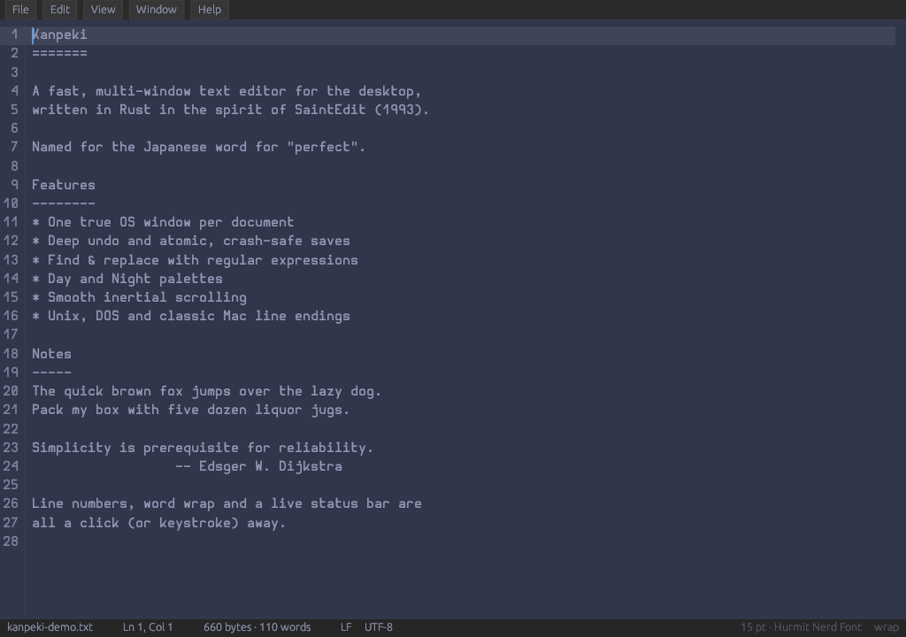
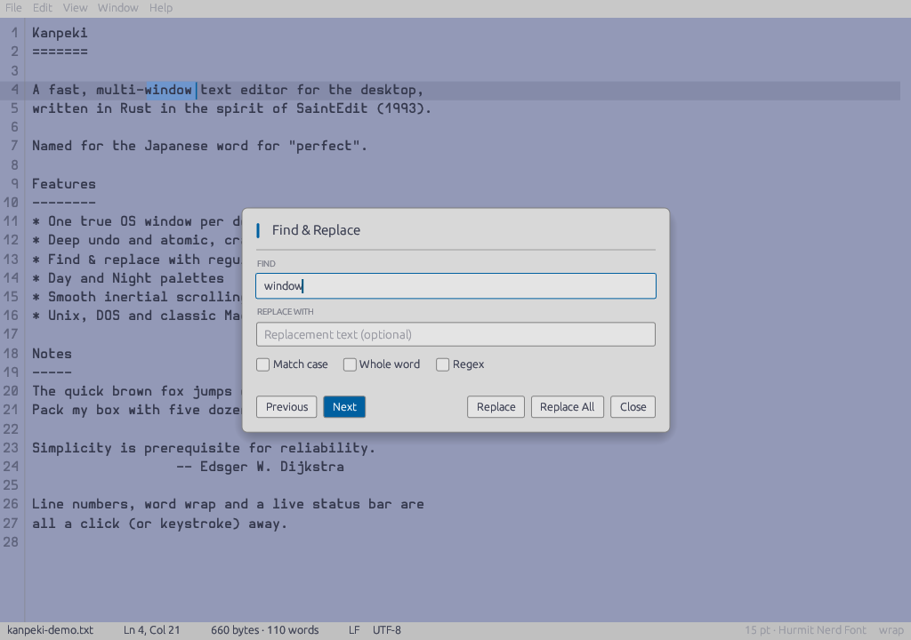

# Kanpeki


A fast, multi-window text editor for the desktop, written in Rust in the spirit
of the classic System 7 editor **SaintEdit** (Craig Marciniak, 1993).

Named for the Japanese word for “perfect”.

## Features

- One true OS window per document, with a Window menu listing every open file
- Deep undo/redo and atomic, crash-safe saves (temp file + fsync + rename)
- Find & replace: plain text or regex, case-sensitive, whole-word
- Duotone Day and Night palettes: `#9399b7` paper and `#32364a` ink, swapped between modes
- Smooth inertial scrolling, vertical and horizontal scrollbars, word wrap, optional line numbers
- Word/line selection, drag-to-select with auto-scroll, grouped undo
- Unix, DOS and classic-Mac line endings detected and preserved on save
- Reads UTF-8 (with BOM), UTF-16 and Latin-1; saves as UTF-8
- Bundled **Hurmit Nerd Font Mono** typeface — no font installation needed
- Large-file friendly (ropey), with word counting on a worker thread
- Native file dialogs for Open and Save (zenity), with built-in fallbacks and overwrite confirmation
- Opens a file named on the command line; remembers the last window size and position

## Screenshots



*Day colours, line numbers and the status bar.*



*Night colours.*



*Find & Replace, with the first match selected.*

## Build

Requires a stable Rust toolchain.

```bash
cargo build --release
./target/release/kanpeki
```

Linux/X11 (built on egui + egui-multiwin + winit).

## Notes

`HANDOFF.md` contains the architecture, implementation notes, and the external
API details that shaped the build.

## Credits

Created by Derek Kalinosky.
Inspired by Craig Marciniak’s SaintEdit (1993) — thank you, Craig.

## License

Released into the public domain under the [Unlicense](LICENSE) — do whatever
you like with it.

The bundled editor typeface, Hurmit Nerd Font Mono (derived from Hermit),
is distributed under the SIL Open Font License 1.1; see
[`assets/fonts/HurmitNerdFont-LICENSE.txt`](assets/fonts/HurmitNerdFont-LICENSE.txt).
